<h1 align="center">Hi, I'm Umer Jamshaid 👋</h1>

  

  <strong>Flutter Developer · Mobile &amp; Web Development · Karachi, Pakistan</strong>

  I build cross-platform apps with Flutter, Dart, and Firebase, with experience in Python and responsive websites.

  
  
  

  

## 🧑‍💻 About me

I enjoy turning designs into responsive interfaces and connecting them to real data. My work includes e-commerce, real-time messaging, and client websites, from Flutter UI components to authentication and REST API integration.

- 📱 Built **Baby Shop Hub**, an e-commerce app with authentication, cart and order flows, and an admin dashboard.
- 💬 Created **Chat Box**, a Firebase-powered messaging app showcased at **Aptech Vision 2025**.
- 🤝 Worked with UI/UX designers during a Flutter internship and with clients on freelance web projects.
- 🌱 Interested in open source, thoughtful UX, and building useful products.
- 💼 Open to **Flutter internships and entry-level developer roles**.

## 🚀 Featured projects

### [Baby Shop Hub](https://github.com/Umerjamshaid/baby_shop_hub)

An e-commerce mobile app for infant and baby products, built with **Flutter, Dart, and Firebase**.

- User authentication, cart management, and order flow.
- Responsive screens with real-time Firebase data.
- Admin dashboard for product management, analytics, and sales tracking.

### Chat Box · Aptech Vision 2025

A real-time chat app built with **Flutter, Dart, Firebase Authentication, and Cloud Firestore**.

- Real-time messaging and user presence.
- Chat interfaces with message bubbles, user status, and timestamps.
- Built with attention to responsiveness across devices.

### [Task Management](https://github.com/Umerjamshaid/Task_Managment) · In development

A freelance Flutter project for tasks, sub-tasks, reminders, and filters. A connection to a companion web app is planned.

**More to explore:** [My portfolio](https://umerjamshaid.github.io/Mac_OS_Portfolio/) · [All repositories](https://github.com/Umerjamshaid?tab=repositories)

## 🛠️ Skills & tools

| Area | Technologies & experience |
| --- | --- |
| Mobile development | Flutter, Dart, state management, responsive UI |
| Backend & integration | Firebase, Firebase Authentication, Cloud Firestore, REST APIs |
| Web development | HTML, CSS, WordPress, Shopify |
| Python | Python, Django |
| Development workflow | Git, GitHub, CI/CD, collaboration with UI/UX designers |

## 💼 Experience

**WordPress / Shopify Developer Intern · Innovative Widget** 
January – June 2024 · Karachi

Built and maintained responsive client websites, managed product catalogs and inventory, and updated content, plugins, and themes.

**Flutter Developer Intern · Utrix Solutions** 
June – September 2023 · Karachi

Developed Flutter UI components, integrated REST APIs, and worked with UI/UX designers to improve app interfaces.

**Freelance Web Developer · TJ Solutions**

Delivered **4+ HTML/CSS client websites** using supplied templates, working directly with clients on requirements, responsive pages, and basic SEO.

## 🎓 Education & training

- **Higher Diploma in Software Engineering** — APTECH Computer Education, Karachi.
- **Python Programming** — Bano Qabil 2.0, four-month course completed in June 2024.
- **WordPress Compact Course** — APTECH Computer Education.

## 📊 GitHub dashboard

  
  

  

### 🧊 Contribution calendar

  

<picture>
  <source media="(prefers-color-scheme: dark)" srcset="https://raw.githubusercontent.com/Umerjamshaid/Umerjamshaid/output/github-contribution-grid-snake-dark.svg" />
  <source media="(prefers-color-scheme: light)" srcset="https://raw.githubusercontent.com/Umerjamshaid/Umerjamshaid/output/github-contribution-grid-snake.svg" />
  
</picture>

### 🏆 Achievements & contributions

<table>
  <tr>
    <td width="50%" valign="top"></td>
    <td width="50%" valign="top"></td>
  </tr>
  <tr>
    <td width="50%" valign="top"></td>
    <td width="50%" valign="top"></td>
  </tr>
</table>

### 💻 Languages & coding activity

<table>
  <tr>
    <td width="50%" valign="top"></td>
    <td width="50%" valign="top"></td>
  </tr>
  <tr>
    <td width="50%" valign="top"></td>
    <td width="50%" valign="top"></td>
  </tr>
</table>

  

### ⌨️ WakaTime

  

📈 More language & activity charts

  
  

  
  

### 🎵 Now playing

  

Find me on [Stack Overflow](https://stackoverflow.com/users/23545267/umer-jamshaid), [X](https://x.com/Umerjamshaidr), or [Discord](https://discord.gg/DXwsVcRnFv).

## 🤝 Let's connect

Have a Flutter opportunity or a project to discuss? Reach me at **[umerjamshaid481@gmail.com](mailto:umerjamshaid481@gmail.com)** or connect on **[LinkedIn](https://www.linkedin.com/in/umer-jamshaid/)**.

  

